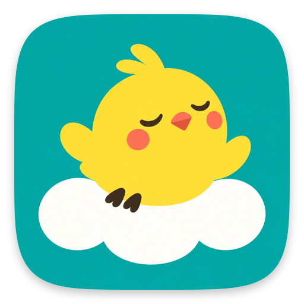
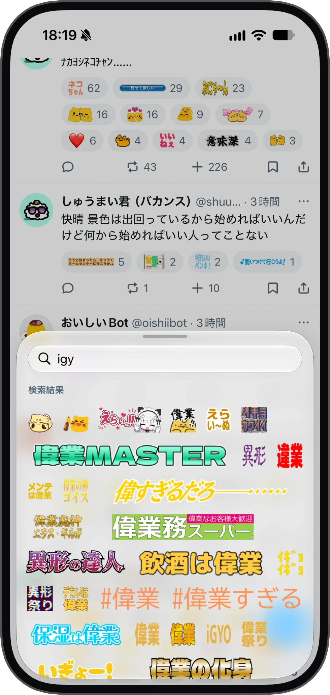
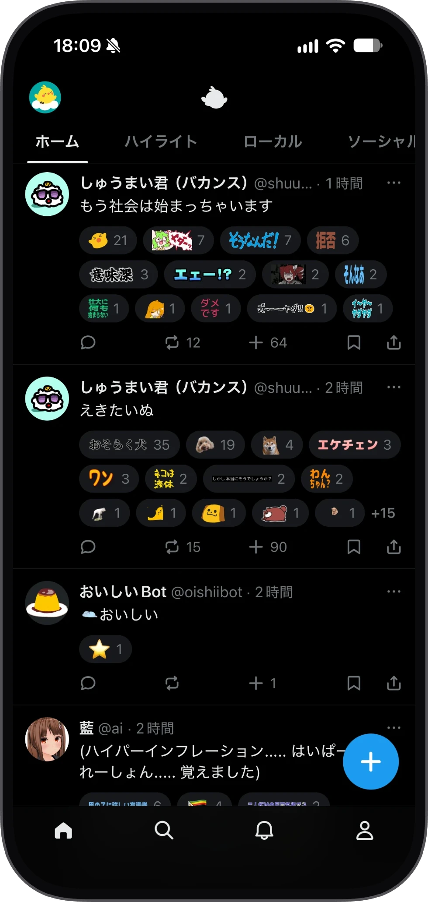

  
  <h1>Hibari for Misskey</h1>
  
<b>リアクションを貼るのも、TLを眺めるのも楽しくなる Misskey クライアント</b>

  

    
  

  
<b><a href="https://apps.apple.com/jp/app/hibari-for-misskey/id6818066575">App Storeで入手（無料）</a></b>

  
<a href="https://misskey.io/@hibariapp">@hibariapp@misskey.io</a>

 

  
  &nbsp;&nbsp;&nbsp;
  

 

**Hibari（ひばり）** は、iPhone・iPad で毎日の Misskey を楽しく快適に過ごすためのクライアントアプリです。

### こんなところがいい感じ

- **リアクションをペタペタ貼るのが楽しい**
  横長のカスタム絵文字もギュッと潰れずにそのままの形でズラッと並ぶピッカーで、使いたい絵文字がサクッと見つかります。押したときに絵文字がぽんっと弾けるエフェクトとコツンと返ってくる振動が気持ちいい！
- **絵文字まみれのTLもぬるぬる動く**
  リアクションが大量についたノートや流速のはやいLTLも、引っかからずにスイスイ眺められます（120Hz対応）。
- **よく見るリストやアンテナをスワイプ巡回**
  ホームやLTLだけでなく、お気に入りのリストやアンテナ、画像・動画だけを追えるメディアタブをホーム画面に並べて、横スワイプでひょいひょい行き来できます。
- **鯖のかけもちもラクラク**
  複数サーバー・複数アカウントを登録して、ホームタブの長押しなどからパッと切り替えられます。
